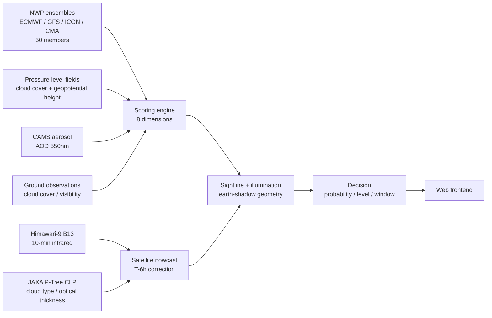

# GlowChaser

**English** | [简体中文](README.zh.md)

A forecasting system for **sky-glow events** — the twenty minutes when a sunset or
sunrise actually catches fire. Built for photographers who have to commit to a
location two hours before they know whether it is worth going.

Deployed and in daily use. Roughly 25k lines of Python behind an 11k-line frontend.

---

## Why this is not a weather app

A normal forecast answers *"will it be cloudy?"* That question is useless here. A sky
full of thin cirrus at the right altitude produces a spectacular burn; the same cloud
cover at the wrong altitude produces a grey wall. What matters is not *how much* cloud
there is, but **where it sits in the light path, whether it is still sunlit, and what
the air between it and the observer is doing to the light**.

GlowChaser models that directly. It converts a weather forecast into a statement about
whether light will reach a specific cloud layer at a specific moment, and whether that
layer will be visible from a specific place on the ground.

---

## Architecture



---

## The hard part: illumination geometry

The central idea is that a cloud only counts as a *canvas* for glow if it is still
receiving direct sunlight. For a cloud at height `h`, the sun must be above the
earth-shadow line:

```
b(h) = acos( R / (R + h) )
```

where `R` is the earth radius. Below that solar elevation the cloud is inside the earth's
shadow and cannot glow, no matter how thick or well placed it is.

This is computed **per atmospheric layer**, not once for the whole column. A high cirrus
deck at 10 km stays lit several minutes longer than a mid-level deck at 4 km, and that
difference decides whether the afterglow is real or an artefact of a naive model.

The sightline is likewise traced through the real pressure levels: for every layer, the
code computes where the observer's line of sight intersects that layer's cloud shell, and
how far away that intersection is. A cloud at 2 km blocking the view 40 km out is a
different problem from the same cloud 8 km out.

---

## Data sources

| Layer | Source | Notes |
|---|---|---|
| Ensemble forecast | Open-Meteo (ECMWF / GFS / ICON / CMA + 50 members) | free tier |
| Cloud at height | Open-Meteo pressure-level `cloudcover_*hPa` + `geopotential_height_*hPa` | 1000–200 hPa, real layer heights |
| Aerosol | Open-Meteo Air Quality (CAMS AOD 550nm, PM2.5) | free tier |
| Satellite IR | JMA Himawari-9 B13 full disk | 10-minute cadence |
| Satellite cloud properties | JAXA P-Tree CLP (cloud type, optical thickness, top temperature) | FTP |
| Ground truth | QWeather (total cloud, visibility, minutely precipitation) | free tier |

---

## Results

Calibration used **366 ground-truth records** back-filled from live forecasts — every day
the system made a prediction, and the actual outcome was recorded afterwards.

- **AUC 0.719** for the 8-dimension score on a 555-day historical backtest.
- Probability calibration by PAVA monotone regression. On a held-out two-month window the
  Brier score improved from 0.255 to **0.170**, against a climatology baseline of 0.174.

See [`docs/ARCHITECTURE.md`](docs/ARCHITECTURE.md) for the scoring model, the calibration
method, and what I would do differently.

---

## Known limitations

This is the part I would read first if I were evaluating the project.

**The system is conservative, and it misses most real events.** On a 374-record
retrospective set from Shanghai, it correctly rejects 92% of non-events, but its
probability of detection (POD) — the fraction of actual glow events it catches — is only
**13.5%**.

The failure is not uniform. It concentrates in **high-cloud-cover scenes**, where
dimension 1 (mid/high cloud quality) systematically under-scores. A thick but well-placed
cirrus shield — exactly the setup that produces the best burns — gets penalised as if it
were a stratus deck.

I know *where* the failure is. I do not yet have the right form for dimension 1. The
current version multiplies a cloud-quality term by an optical-path penalty, and the
coefficients were fitted on a dataset too small to separate the two effects.

Other limitations:

- **Satellite resolution.** Himawari B13 is 601 px across the full disk, about
  **26.9 km per pixel** over the Pearl River Delta. Cloud bands narrower than that are
  invisible to the nowcast.
- **Calibration scope.** The system is tuned for the Pearl River Delta. National coverage
  exists but is uncalibrated.
- **Horizon.** Beyond roughly 72 h the ensemble spread is wide enough that the
  probability output degenerates toward climatology.
- **Threats.** Nothing in the scoring is learned end-to-end; every coefficient was set by
  hand or by grid search. This is a deliberate choice for interpretability, but it caps
  how well the system can generalise.

---

## Repository layout

```
app/
  core/          astronomy, geometry, illumination, scoring
  services/      data acquisition, caching, report generation
  static/        frontend
scripts/         data download and backtest drivers
tests/           unit tests, backtest harness, visual regression
data/
  glow_labels.csv   366 labelled records (the only data file kept in the repo)
docs/
  ARCHITECTURE.md   deeper notes on the scoring model
```

---

## Running it

```bash
python -m pip install -r app/requirements.txt

cp app/config_private.example.json app/config_private.json
# then fill in your QWeather key and, optionally, JAXA P-Tree credentials

python -m uvicorn app.main:app --host 0.0.0.0 --port 8000
```

The system runs without credentials in a reduced mode: ensemble and aerosol data are
free, while ground observations and satellite cloud products need keys.

---

## A note on the name

逐光者 — *the one who chases the light*. It is what photographers do, and it is also a
fair description of what the code does: it computes where the light will still be
reaching, and when.
