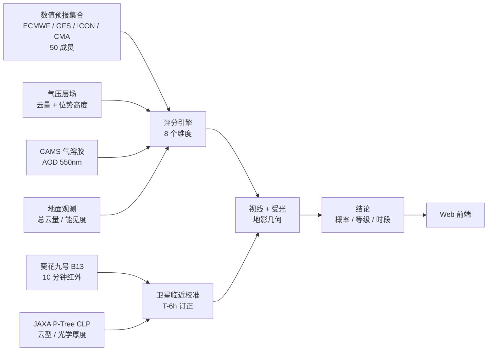

# GlowChaser 逐光者

**简体中文** | [English](README.md)

火烧云预测系统。给定城市、日期和朝霞/晚霞，输出一个概率和一段人话结论。

已上线，有实际用户。约 25k 行 Python，前端 11k 行。

## 为什么不能直接看天气 App

天气 App 说明天多云。多云这两个字在这里没有用。

决定烧不烧的是三件事：云在哪一层、那一刻还受不受光、从你的机位看过去中间挡不挡。云量本身说明不了什么。

薄卷云在 10 km 能烧成一片，同样多的云掉到 3 km 就只是一层灰。都是多云，两个结果。

GlowChaser 算的就是这件事。

## 架构



## 受光判据

一朵云得还晒得到太阳才有用。对高度 h 的云层，太阳高度角要高过地影线：

```
b(h) = acos( R / (R + h) )
```

低于这个角度，那层云就进了地球影子，再厚也烧不起来。

这个值是逐层算的，不是整层取平均。10 km 的卷云比 4 km 的中云多受光几分钟，反烧到底是不是真的，就看这几分钟。

视线也一样，按真实气压层追：每层算出视线和云壳的交点离你多远。2 km 的云挡在 40 km 外，和挡在 8 km 外，不是一回事。

## 数据源

| 层级 | 来源 | 说明 |
|---|---|---|
| 集合预报 | Open-Meteo（ECMWF / GFS / ICON / CMA + 50 成员） | 免费额度 |
| 分层云况 | Open-Meteo 气压层 `cloudcover_*hPa` + `geopotential_height_*hPa` | 1000–200 hPa，真实层高 |
| 气溶胶 | Open-Meteo Air Quality（CAMS AOD 550nm、PM2.5） | 免费额度 |
| 卫星红外 | JMA 葵花九号 B13 全圆盘 | 10 分钟节奏 |
| 卫星云特性 | JAXA P-Tree CLP（云型、光学厚度、云顶温） | FTP |
| 地面实况 | 和风天气（总云量、能见度、分钟级降水） | 免费额度 |

## 结果

真值 366 条，全部从实盘预报回填——每天给一个判断，事后记结果。

555 天回测，8 维评分 AUC 0.719。

概率校准用 PAVA 保序回归。留出两个月窗口，Brier 从 0.255 降到 0.170，气候态基线是 0.174。

评分模型和校准细节见 [docs/ARCHITECTURE.md](docs/ARCHITECTURE.md)。

## 已知局限

系统偏保守，漏掉大部分真实事件。上海 374 条回溯集上，92% 的"没烧"判对了，命中率只有 13.5%。

失效集中在高云量场景。维度 1 在这一档系统性给低分：厚但位置好的卷云盾，恰恰是烧得最猛的那种配置，被当层积云一样扣。

知道问题出在哪，但维度 1 的函数形式还没找对。现在是拿云质量项乘光路惩罚项，系数拟合用的数据集太小，两个效应分不开。

其他几条：

- 葵花 B13 全圆盘 601 像素，珠三角约 26.9 km/像素，更窄的云带看不见
- 只按珠三角校准过，全国覆盖有，但没调
- 超过 72 小时集合离散度太大，概率退化成气候态
- 评分里没有端到端学出来的部分，系数全部手工定或网格搜。为了可解释性这么做，代价是泛化上限

## 仓库结构

```
app/
  core/          天文、几何、受光、评分
  services/      数据获取、缓存、报告生成
  static/        前端
scripts/         数据下载与回测驱动
tests/           单元测试、回测框架、视觉回归
data/
  glow_labels.csv   366 条标注记录（仓库里唯一保留的数据文件）
docs/
  ARCHITECTURE.md   评分模型的详细说明
```

## 跑起来

```bash
python -m pip install -r app/requirements.txt

cp app/config_private.example.json app/config_private.json
# 填入和风天气 key，JAXA P-Tree 凭据可选

python -m uvicorn app.main:app --host 0.0.0.0 --port 8000
```

没凭据也能跑，只是能力受限：集合预报和气溶胶免费，地面实况和卫星云特性要 key。

## 名字

逐光者，追光的人。
