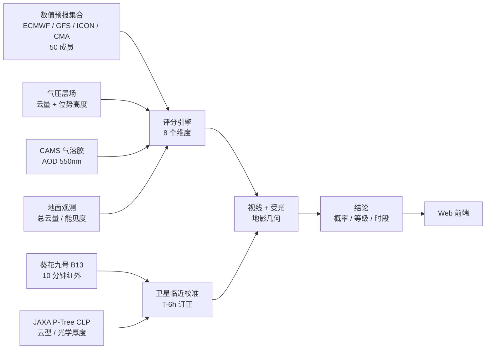

# GlowChaser 逐光者

**简体中文** | [English](README.md)

预测**霞光事件**的系统——日落或日出真正烧起来的那二十分钟。给那些必须在还不知道值不值得去之前、就得提前两小时定下机位的摄影师。

已上线，有实际用户。约 25k 行 Python，前端 11k 行。

---

## 为什么这不是一个天气 App

普通预报回答的是"会不会多云"。这个问题在这里没有用。薄卷云在对的高度上会烧出一片天，同样的云量错一个高度就只剩一堵灰墙。

关键不是**云有多少**，而是**它落在光路的哪个位置、是否仍然受光、以及它和你之间那段空气在对光做什么**。

GlowChaser 直接对这些建模。它把一份天气预报，翻译成两个判断：某一层云在某一刻还能不能收到直射阳光；以及那一层云，从地面上某个具体位置看过去，可不可见。

---

## 架构



---

## 最难的那部分：受光几何

核心想法只有一句：**一朵云只有在还收得到直射阳光的时候，才算得上霞光的画布。**

对高度为 `h` 的云层，太阳必须高过地影线：

```
b(h) = acos( R / (R + h) )
```

其中 `R` 是地球半径。太阳高度角低于这条线，那层云就落在地球影子里，无论它多厚、位置多好，都烧不起来。

这个判据是**逐气压层**算的，不是对整层大气算一个平均值。10 km 的卷云比 4 km 的中云要多受光好几分钟，而这几分钟的差别，恰恰决定了反烧是真的存在，还是一个粗糙模型算出来的假象。

视线同样按真实气压层追踪：对每一层，算出观测者视线与该层云壳的交点落在多远的地方。一朵 2 km 的云挡在 40 km 外，和同一朵云挡在 8 km 外，是两个问题。

---

## 数据源

| 层级 | 来源 | 说明 |
|---|---|---|
| 集合预报 | Open-Meteo（ECMWF / GFS / ICON / CMA + 50 成员） | 免费额度 |
| 分层云况 | Open-Meteo 气压层 `cloudcover_*hPa` + `geopotential_height_*hPa` | 1000–200 hPa，真实层高 |
| 气溶胶 | Open-Meteo Air Quality（CAMS AOD 550nm、PM2.5） | 免费额度 |
| 卫星红外 | JMA 葵花九号 B13 全圆盘 | 10 分钟节奏 |
| 卫星云特性 | JAXA P-Tree CLP（云型、光学厚度、云顶温） | FTP |
| 地面实况 | 和风天气（总云量、能见度、分钟级降水） | 免费额度 |

---

## 结果

校准用了 **366 条真值记录**，全部由实盘预报回填——每天系统给出一个判断，事后把真实结果记下来。

- 8 维评分在 **555 天**历史回测上达到 **AUC 0.719**。
- 概率校准用 **PAVA 保序回归**。在一个留出的两个月窗口上，Brier 分数从 0.255 降到 **0.170**，而气候态基线是 0.174。

评分模型、校准方法和"我会怎么改"都写在 [`docs/ARCHITECTURE.md`](docs/ARCHITECTURE.md)。

---

## 已知局限

如果我在评估这个项目，这一节会是我最先读的。

**这套系统偏保守，而且漏掉了大部分真实事件。** 在一个 374 条记录的上海回溯集上，它把 92% 的"没烧"判对了；但命中率（POD，真实事件中被抓到的比例）只有 **13.5%**。

失效不是均匀分布的。它集中在**高云量场景**：维度 1（中高层云质量）在这一档系统性给低分。一片厚但位置极好的卷云盾——恰恰是烧得最猛的那种配置——被当成层积云一样扣分。

我知道失效**在哪**，但还没有维度 1 的正确函数形式。当前版本是拿一个云质量项去乘一个光路惩罚项，而系数是在一个小到无法把这两个效应分开的数据集上拟合出来的。

其他局限：

- **卫星分辨率。** 葵花 B13 全圆盘只有 601 像素，在珠三角约 **26.9 km/像素**。比这更窄的云带，临近校准根本看不见。
- **校准范围。** 系统是为珠三角调的。全国覆盖存在，但没有校准。
- **时效。** 超过约 72 小时，集合离散度大到概率输出退化为气候态。
- **技术路线。** 评分里没有任何一部分是端到端学出来的；每个系数都是手工设定或网格搜索得到的。这是为了可解释性做的取舍，但它也封死了系统泛化的上限。

---

## 仓库结构

```
app/
  core/          天文、几何、受光、评分
  services/      数据获取、缓存、报告生成
  static/        前端
scripts/         数据下载与回测驱动
tests/           单元测试、回测框架、视觉回归
data/
  glow_labels.csv   366 条标注记录（仓库里唯一保留的数据文件）
docs/
  ARCHITECTURE.md   评分模型的详细说明
```

---

## 跑起来

```bash
python -m pip install -r app/requirements.txt

cp app/config_private.example.json app/config_private.json
# 填入你的和风天气 key，可选填 JAXA P-Tree 凭据

python -m uvicorn app.main:app --host 0.0.0.0 --port 8000
```

没有凭据也能跑，只是能力受限：集合预报和气溶胶数据是免费的，地面实况和卫星云特性需要 key。

---

## 关于这个名字

逐光者——追光的人。这是摄影师在做的事，也恰好是这段代码在做的事：算清楚光还会照到哪里，以及什么时候。
